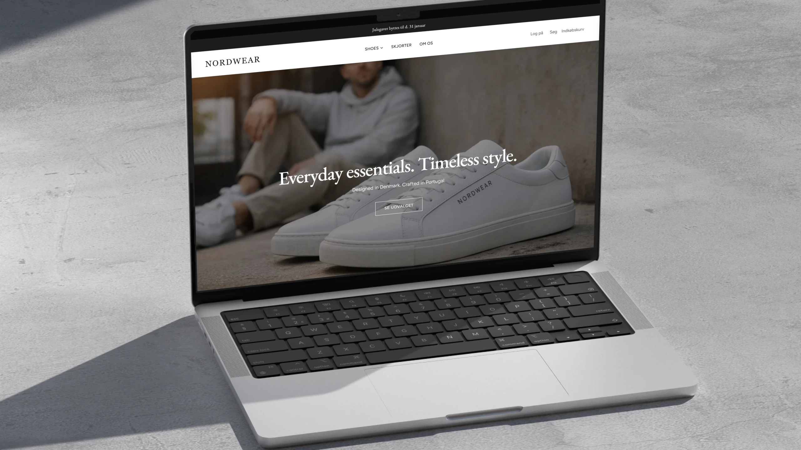

# NordWear

This project is a full-stack e-commerce application for the fictional brand NordWear.

## Showcase

The homepage scrolling on a MacBook mockup, as a 7 second seamless loop with no audio:

-   [`nordwear-homepage-loop.webm`](docs/showcase/nordwear-homepage-loop.webm) (VP9, 3680x2760, 60 fps)
-   [`nordwear-homepage-loop.mp4`](docs/showcase/nordwear-homepage-loop.mp4) (H.264, 2304x1728, 60 fps)

## Reviewer & Testing Information

To assist with reviewing and testing the application, here are the necessary credentials and instructions.

### User Accounts

For testing the application from different user perspectives, you can use the following pre-seeded accounts:

-   **Admin User:**
    -   **Email:** `admin@example.com`
    -   **Password:** `admin123`

-   **Standard User:**
    -   **Email:** `user@example.com`
    -   **Password:** `user123`

### Test Checkout (Stripe)

The application uses Stripe for payment processing. You can perform a complete checkout flow without using real money by using the following test card details at the payment step:

-   **Card Number:** `4242 4242 4242 4242`
-   **Expiration Date:** `12 / 26`
-   **CVC:** `123`
-   **Name on Card / Postal Code:** Any value can be used.